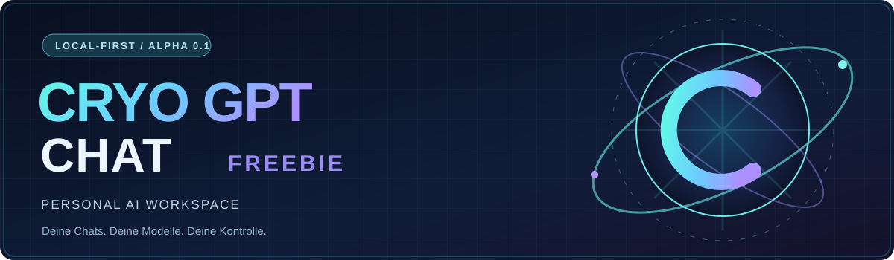

<div align="center">



# CryoGPTCHATFREEBIE

**Deine Chats. Deine Modelle. Deine Kontrolle.**

Ein lokal betriebener KI-Chat mit optionaler **Ollama-Anbindung**, Gesprächsverwaltung und JSON-Backups.  
Kein Cloud-Zwang, keine verpflichtenden API-Schlüssel, kein KI-Fake-Modus.

**Alpha 0.1** · **Node.js 20+** · **Browser-Frontend** · **Local-first**

[Starten](#-lokal-starten) · [Funktionen](#-bereits-umgesetzt) · [KI einrichten](#-ollama-optional) · [Tests](#-tests) · [Roadmap](#-roadmap)

</div>

---

## 🚀 Lokal starten

Voraussetzung: [Node.js](https://nodejs.org/) **Version 20 oder höher**. Das Projekt hat **keine externen npm-Abhängigkeiten**.

```bash
git clone https://github.com/Pierreg99/CryoGPTCHATFREEBIE.git
cd CryoGPTCHATFREEBIE
npm start
```

Anschließend **[http://127.0.0.1:4173](http://127.0.0.1:4173)** im Browser öffnen.

Ohne KI-Modell speichert der Chat Texte als **lokale Notizen**. Er erfindet keine KI-Antworten.

## 🧠 Ollama (optional)

1. [Ollama installieren](https://ollama.com/).
2. Ein lokal nutzbares Modell herunterladen, beispielsweise:
   ```bash
   ollama pull qwen2.5:3b
   ```
3. Sicherstellen, dass Ollama auf `127.0.0.1:11434` läuft.
4. In CryoGPTCHATFREEBIE **↻** klicken und im Modellmenü das lokale Modell auswählen.

Bei Bedarf kann die Ollama-URL beim Start über die Umgebungsvariable `OLLAMA_URL` gesetzt werden. Für die normale lokale Nutzung ist keine Konfiguration erforderlich.

> **Hardware-Hinweis:** Die Modellgeschwindigkeit hängt von RAM, CPU und GPU ab. Für ältere Grafikkarten gibt es keine Leistungszusage; ein kleines quantisiertes Modell kann sinnvoll sein.

## ✨ Bereits umgesetzt

| Funktion | Status |
| --- | --- |
| Responsive Chat-Oberfläche mit dunklem Neon-Design | ✅ |
| Gespräche erstellen, auswählen, umbenennen und löschen | ✅ |
| Volltextsuche in Titeln und Nachrichten | ✅ |
| Lokale Browser-Speicherung mit `localStorage` | ✅ |
| JSON-Backup exportieren und validiert importieren | ✅ |
| Lokale Ollama-Modelle erkennen und auswählen | ✅ |
| Fragen an Ollama senden und echte Textantworten anzeigen | ✅ |
| Automatisierte Node.js-Tests und GitHub Actions | ✅ |
| Streaming, Nutzerauthentifizierung, Cloud-Synchronisation | ⏳ Nicht enthalten |

## 🧩 Architektur

```text
Browser / HTML + CSS + JavaScript
    ├─ src/app.js       Oberfläche, Interaktion, lokale Speicherung
    ├─ src/core.js      testbare Gesprächslogik & Backup-Validierung
    └─ localStorage     lokale Chatdaten (unverschlüsselt)
           │
           │ /api/status + /api/chat
           ▼
    server.mjs          lokaler Node.js-HTTP-Server (127.0.0.1:4173)
           │
           ▼
    Ollama (optional)   lokal installiertes Textmodell (127.0.0.1:11434)
```

Der Browser zeigt Nachrichten als Text, nicht als unkontrolliertes HTML. Der lokale HTTP-Server bindet ausschließlich an `127.0.0.1`, prüft Chat-Anfragen und dient nur vordefinierte Dateien aus.

## 🧪 Tests

```bash
npm test
```

Die vorhandenen Core-Tests prüfen das Datenschema, Chat-Erstellung, Titelfunktion, Suche, Löschen, Backup-Roundtrip, Eingabelimits und Nachrichtenformat für Ollama. GitHub Actions führt sie für Pull Requests unter Node.js 20 und 22 aus.

**Einschränkung:** Browser-End-to-End-Tests und echte Ollama-Inferenztests sind für die Alpha noch offen. Die Illustrationen in der README sind Designgrafiken, keine Laufzeit-Screenshots.

## 🔐 Datenschutz und Grenzen

- Die Chats werden **unverschlüsselt** in deinem Browserprofil abgelegt; exportierte JSON-Dateien sind ebenfalls unverschlüsselt.
- Beim Einsatz von Ollama erhält das konfigurierte Modell die letzten Nachrichten der aktuellen Unterhaltung. Standardmäßig läuft diese Verbindung lokal.
- Der Entwicklungsserver besitzt **kein Login und keinen Mehrbenutzerschutz**. **Nicht im öffentlichen Internet bereitstellen!**
- Der Server wurde für lokale Entwicklungszwecke konzipiert, nicht als produktionsreife SaaS-Plattform.
- Der Import ersetzt nach ausdrücklicher Bestätigung die bisherigen Chats. Vorher empfiehlt sich ein Export.
- Keine Versprechen für Cloud-Anbieter oder kostenpflichtige APIs, die in dieser Version nicht eingebaut sind.

## 🛠️ Roadmap

- [x] **Alpha 0.1:** Lokaler Chat, Ollama, Notizmodus, Suche, Import/Export, Tests.
- [ ] **Alpha 0.2:** Antwort-Streaming, Abbrechen laufender KI-Generierungen, besseres Fehlermanagement.
- [ ] **Alpha 0.3:** Versionierte IndexedDB, größere Chatverläufe, Barrierefreiheit und Browser-End-to-End-Tests.
- [ ] **Später:** Optionaler GitHub-/Cryo-Omega-Skill-Katalog und kontrollierte Agenten-Workflows.

Beiträge und Bugmeldungen sind willkommen. Bitte keine persönlichen Chat-Backups, API-Schlüssel oder Passwörter in öffentliche Issues hochladen.

---

<div align="center"><sub>CRYO GPT CHAT FREEBIE · LOCAL FIRST · BUILD WITHOUT LIMITS</sub></div>
