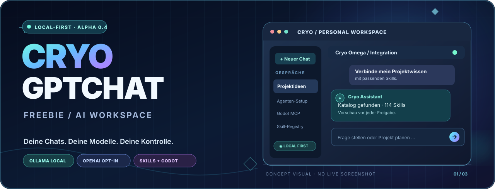
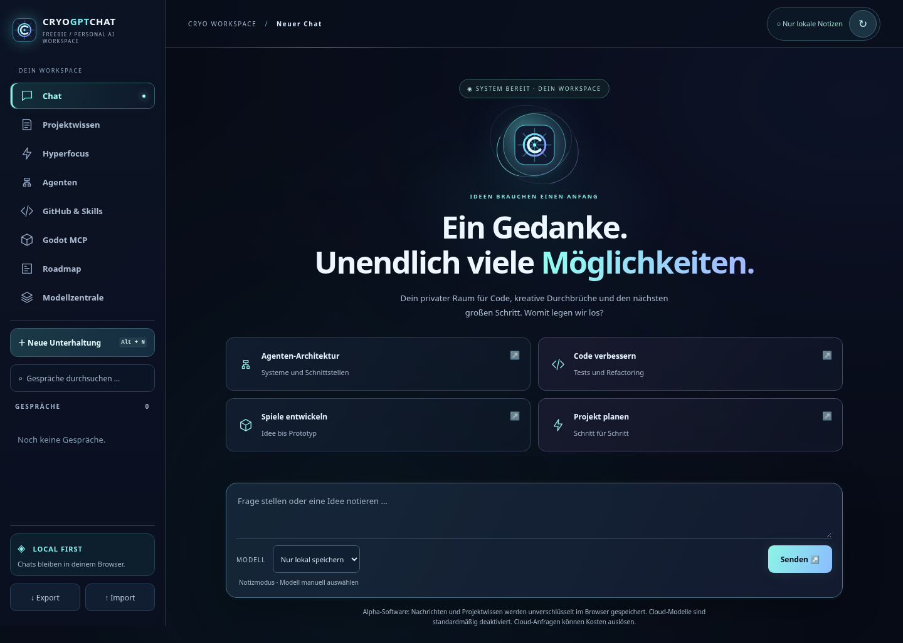
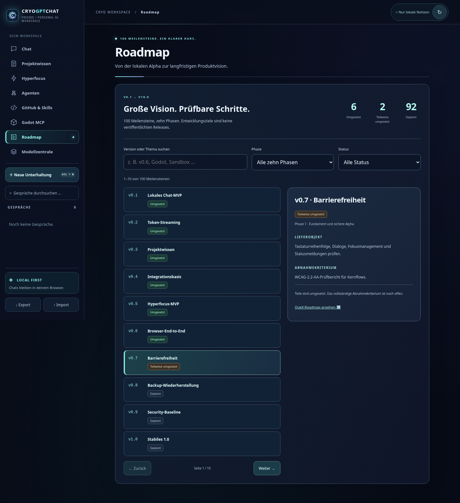
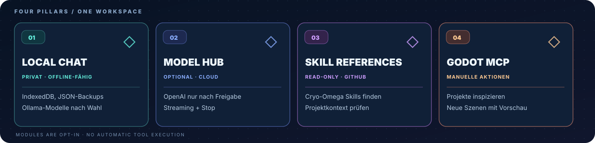
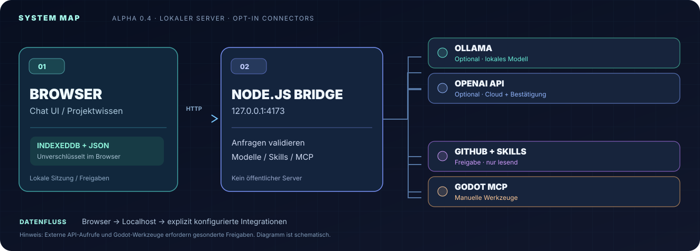

<div align="center">
  

  # ❄️ CryoGPTCHATFREEBIE

  **Deine Chats. Deine Modelle. Deine Kontrolle.**

  Local-First KI-Workspace für Chats, Projektwissen und Entwickler-Workflows.  
  **Ollama lokal**, **OpenAI optional**, **GitHub-/Cryo-Omega-Skills als geprüfte Referenz** und **Godot MCP nur mit manueller Freigabe**.

  <p>
    <code>ALPHA 0.4</code> ·
    <code>LOCAL FIRST</code> ·
    <code>NODE.JS 20+</code> ·
    <code>MODEL PROVIDERS: OPT-IN</code>
  </p>

  <p>
    <a href="#-schnellstart"><strong>▶ Schnellstart</strong></a> ·
    <a href="#-funktionen">Funktionen</a> ·
    <a href="#-drei-designwelten">Designwelten</a> ·
    <a href="#-systemarchitektur">Architektur</a> ·
    <a href="#-datenschutz--grenzen">Sicherheit</a> ·
    <a href="docs/roadmap/ROADMAP-100.md">100-Versionen-Roadmap</a>
  </p>
</div>

---

## ❄️ Cryo-Neon-Workspace



Acht eigene Ansichten einschließlich einer durchsuchbaren Roadmap mit allen 100 Versions-Meilensteinen, mobile Navigation, einheitliche Freigabedialoge und reduzierte Bewegung auf Wunsch. Neu sind Modellfavoriten, kopierbare Nachrichten, Skill-Karten, lokale Hyperfocus-Historie und einzeln freigegebene Agenten-Schrittfolgen. Markdown-Ausgaben lokal oder über neue GitHub-Branches und PRs bleiben standardmäßig gesperrt und benötigen eigene serverseitige Opt-ins. [Bedienung, Konfiguration und Grenzen →](docs/workspace.md)

### Alle Versionen im Blick



Suche nach Themen oder Versionsnummern, filtere nach Phase und Status und prüfe Lieferobjekt und Abnahmekriterium jeder Version. Die Ansicht liest die bestehende Markdown-Roadmap; geplante Funktionen bleiben als geplant gekennzeichnet.

## ✨ Funktionen



| Funktion | Im aktuellen Stand |
| :--- | :--- |
| **Chat & Daten** | Responsive Oberfläche, Volltextsuche, IndexedDB, JSON-Export/-Import und gespeichertes Projektwissen |
| **KI-Modelle** | Ollama lokal; optional OpenAI API mit serverseitigem Schlüssel und Bestätigung **vor jeder** Cloud-Anfrage |
| **Integrationen** | README-/Datei-/Strukturvorschau, Skill-Karten, Agenten-Schrittfolgen und optionale geprüfte Markdown-Ausgabe |
| **Godot MCP** | Versions- und Projektinspektion; neue Szenen ausschließlich nach Opt-in, Vorschau und Bestätigung |

> **Die SVG-Banner sind Konzeptillustrationen.** Echte Screenshots und Bedienhinweise zum neuen Workspace stehen in [docs/workspace.md](docs/workspace.md). Ohne ausgewähltes Modell arbeitet die App als lokales Chat-Notizbuch; sie simuliert keine KI-Antworten.

## 🚀 Schnellstart

**Voraussetzung:** [Node.js](https://nodejs.org/) 20 oder neuer. Keine npm-Laufzeitabhängigkeiten; Browser-Tests verwenden Entwicklungsabhängigkeiten.

```bash
git clone https://github.com/Pierreg99/CryoGPTCHATFREEBIE.git
cd CryoGPTCHATFREEBIE
npm start
```

Öffne danach **[http://127.0.0.1:4173](http://127.0.0.1:4173)** auf demselben Rechner.

### Optional: Ollama verbinden

1. [Ollama installieren](https://ollama.com/).
2. Ein kompaktes lokales Modell herunterladen: `ollama pull qwen2.5:3b`.
3. Ollama lokal unter `127.0.0.1:11434` betreiben.
4. In CryoGPTCHATFREEBIE die Modellliste aktualisieren und dein Modell auswählen.

Der Modellserver ist über `OLLAMA_URL` konfigurierbar. Eine Internetverbindung ist möglicherweise einmalig nötig, um das Modell herunterzuladen; **KI-Antworten benötigen danach keine obligatorische Cloud-API**.

## 🎨 Drei Designwelten

Die **drei ursprünglichen Designwelten** bleiben erhalten. Jede besitzt einen eigenen editierbaren SVG-Header. Die neue Hauptansicht kombiniert Produktklarheit, holografische Cyan-/Violett-Akzente und gut lesbare Architektur-Grafiken.

<table>
<tr>
<td width="33%" align="center">
<a href="docs/readme-variants/01-clean.md"></a>
<br><strong>01 · Professional / Clean</strong>
<br>Minimalistisch, technisch, gut lesbar.
<br><a href="docs/readme-variants/01-clean.md">Variante öffnen →</a>
</td>
<td width="33%" align="center">
<a href="docs/readme-variants/02-neon.md"></a>
<br><strong>02 · Futuristic / Neon</strong>
<br>Holografisch, kontrastreich, cineastisch.
<br><a href="docs/readme-variants/02-neon.md">Variante öffnen →</a>
</td>
<td width="33%" align="center">
<a href="docs/readme-variants/03-product.md"></a>
<br><strong>03 · App / Landing Page</strong>
<br>Produktnutzen, Einstieg und FAQ.
<br><a href="docs/readme-variants/03-product.md">Variante öffnen →</a>
</td>
</tr>
</table>

**Alle Grafiken liegen im Repository:** [`assets/readme/`](assets/readme/). Keine externen Bild-CDNs notwendig.

## 🧩 Systemarchitektur



| Schicht | Dateien | Aufgabe |
| :--- | :--- | :--- |
| **Browser** | [`index.html`](index.html), [`src/app.js`](src/app.js), [`src/styles.css`](src/styles.css) | Chat-Oberfläche, Nachrichten, Sitzungen, Suche |
| **Chat-Core** | [`src/core.js`](src/core.js) | Datenlogik, Projektwissen und Backup-Validierung |
| **Speicherung** | [`src/storage.js`](src/storage.js) | IndexedDB-Snapshots, Migration und Fallback |
| **Local Server** | [`server.mjs`](server.mjs), [`src/providers.mjs`](src/providers.mjs) | Localhost-Bridge, Ollama und optionales OpenAI-Streaming |
| **Integrationen** | [`src/github-integration.mjs`](src/github-integration.mjs), [`src/agent-ui.js`](src/agent-ui.js) | Freigegebene GitHub-Leseaktionen und kontrollierte Agentenschritte |
| **Godot MCP** | [`src/godot-mcp-client.mjs`](src/godot-mcp-client.mjs), [`src/godot-scene-plan.mjs`](src/godot-scene-plan.mjs) | Manuelle Projektprüfung und optional neue Szenen |
| **Tests & CI** | [`tests/core.test.js`](tests/core.test.js), [`.github/workflows/ci.yml`](.github/workflows/ci.yml) | Automatische Core-Tests |

### 🧪 Tests und Qualität

```bash
npm test
```

Automatisierte Node- und Browser-Tests decken Core, Streaming, Speicherung, GitHub-Adapter, optionale Modellanbieter, Agentenfreigaben und Godot-MCP-Mockabläufe ab. Browser- und Accessibility-Tests starten mit `npm ci`, `npx playwright install chromium` und `npm run test:e2e` (Node 24 empfohlen). Externe Dienste werden simuliert; echte Ollama-Inferenz bleibt separat zu prüfen.

## 🔐 Datenschutz & Grenzen

- Chats und Projektwissen liegen **unverschlüsselt in IndexedDB** des jeweiligen Browserprofils. Falls IndexedDB nicht verfügbar ist, kommt `localStorage` als Fallback zum Einsatz. Auch JSON-Exporte sind unverschlüsselt.
- Bei Ollama wird Gesprächskontext an den konfigurierten Modellserver gesendet. **Bei explizit ausgewählter OpenAI API** werden freigegebene Inhalte an den Cloud-Anbieter übertragen; es können zusätzliche API-Kosten entstehen.
- Der Node.js-Server bindet an `127.0.0.1`; es gibt **keine Authentifizierung und keinen Mehrbenutzerbetrieb**.
- **Nicht unverändert öffentlich ins Internet stellen.** Dies ist ein lokales Experiment, keine produktionsreife SaaS-Lösung.
- Vor einem JSON-Import ein Backup exportieren; bestätigter Import ersetzt den aktuellen Datenbestand.

## 🤖 Alpha 0.4 · Optionale KI-Anbieter und kontrollierte Agentenschritte

**Neu:** Ollama und eine optionale OpenAI-Chat-Completions-API können in derselben Modellauswahl genutzt werden. Die OpenAI-Anbindung benötigt serverseitig `OPENAI_API_KEY` **und** die explizite Modell-Allowlist `CRYO_OPENAI_MODELS`. Cloud-Nutzung bleibt standardmäßig aus; vor jeder Cloud-Anfrage wird der Nutzer gefragt. Die OpenAI API ist separat kostenpflichtig.

Der **Agenten-Workspace** zeigt für erlaubte GitHub-Leseaktionen zunächst einen Plan. Erst nach expliziter Freigabe wird **genau ein** Schritt ausgeführt: README lesen oder den Cryo-Omega-Skill-Katalog durchsuchen. Ergebnisse werden nur auf Knopfdruck in einen Nachrichtenentwurf übertragen; sie starten keinen autonomen Agenten.

**Einrichtung, Datenschutz und Grenzen:** [Modellanbieter & Agentenschritte](docs/model-providers-and-agents.md). Kein GitHub-Schreibzugriff, keine Shell-Kommandos und keine automatische Ausführung von Skills.

## 🔌 Optionale Integrationen (experimentell)

Die neue GitHub-Anbindung kann explizit freigegebene **öffentliche** Repositories und den Cryo-Omega-Skill-Katalog schreibgeschützt einlesen. Die App zeigt eine Vorschau und übernimmt Inhalte nur nach deiner Bestätigung als privates Projektwissen. **Keine automatischen KI-Aufrufe, keine GitHub-Schreibrechte und keine Skill-Ausführung.**

```bash
CRYO_GITHUB_REPOS=Pierreg99/CryoGPTCHATFREEBIE,Pierreg99/cryo-omega-AI-Agentic-Learn-Packages npm start
```

Öffne dann im Chat **Projektwissen → GitHub & Cryo-Omega Skills**. Ohne diese Umgebungsvariable bleibt die Integration ausgeschaltet. Weitere Hinweise und API-Details: [Integrationsanleitung](docs/integrations.md).

## 🧠 Projektwissen je Chat

Über **„Projektwissen“** kannst du pro Unterhaltung wichtige Ziele, Architekturentscheidungen und Hintergrundinfos in einem eigenen Textfeld speichern (maximal **4.000 Zeichen**).

**Datenschutz und Kontrolle:** Standardmäßig werden diese Notizen **nicht** an ein Modell gesendet. Erst wenn du **„Bei KI-Antworten berücksichtigen“** aktivierst und speicherst, werden sie bei der nächsten Anfrage als normaler, vom Nutzer bereitgestellter Kontext mitgegeben – **nicht** als privilegierte Systemanweisung. Bei extern konfiguriertem Ollama oder ausdrücklich ausgewähltem OpenAI-Modell können diese Notizen folglich an diesen Anbieter übertragen werden.

### Bessere Chat-Speicherung

- **IndexedDB:** gesamter Chat-Stand als atomarer Snapshot gespeichert; Schreibzugriffe erfolgen nacheinander.
- **Sichere Migration:** Beim ersten Start wird eine vorhandene Alpha-0.1/0.2-Speicherung aus `localStorage` gelesen, zu Backup-Version 2 migriert und erst **nach erfolgreichem IndexedDB-Commit** aus dem alten Speicher entfernt.
- **Alte Backups:** JSON-Backups mit Version 1 lassen sich weiterhin importieren. Neue Exporte enthalten auch das Projektwissen und die Freigabe-Einstellung.
- **Fallback:** Wenn IndexedDB nicht verfügbar ist, wird `localStorage` genutzt und eine Warnung angezeigt.
- **Kein Cloud-Sync und keine Verschlüsselung:** Browserdaten können beim Löschen des Profils verloren gehen; wichtige Chats regelmäßig als JSON exportieren.

**Noch nicht enthalten:** automatische Wissenssuche (RAG), beliebiger lokaler Dateizugriff, GitHub-Schreib-/Cloud-Sync, autonome Skill-Ausführung oder browserübergreifende Synchronisierung.

## 🎮 Godot MCP – optionale lokale Projektprüfung

CryoGPTCHATFREEBIE kann über eine **manuell konfigurierte** Verbindung zu [Coding-Solo/godot-mcp](https://github.com/Coding-Solo/godot-mcp) zwei Godot-Abfragen ausführen:

- **Installierte Godot-Version** anzeigen (`get_godot_version`)
- **Projektmetadaten** für einen fest konfigurierten lokalen Godot-Projektordner auslesen (`get_project_info`)

Über den Button **🎮 Godot MCP** öffnet sich ein eigenes Panel. Jede Abfrage erfordert einen weiteren Bestätigungsdialog. Ohne lokale Installation bleibt das Panel deaktiviert; KI-Modelle können nicht automatisch auf Godot-Werkzeuge zugreifen.

**Keine bestehende Szene bearbeiten, kein Spiel automatisch starten.** Ab Alpha 0.4 kann optional eine *neue* Szene nach Vorschau, aktivierter Schreibfreigabe und manueller Bestätigung angelegt werden. Das externe MCP-Programm kann trotzdem ausführbaren Godot-Code starten. Der externe Godot-MCP-Prozess selbst ist ausführbarer Fremdcode und muss vor der Verwendung geprüft werden. Die Integration ersetzt weder eine Sicherheitsprüfung noch eine echte Godot-End-to-End-Testumgebung.

**[Godot MCP installieren, Szenenerstellung aktivieren und Grenzen prüfen →](docs/integrations/godot-mcp.md)**

## 🧱 Alpha 0.4 – neue Godot-Szene mit Vorschau

Im Godot-Panel steht nun ein optionaler Szenenassistent bereit. Er erlaubt **Node2D**, **Node3D** oder **Control** als neuen Wurzelknoten und schreibt ausschließlich **neue Dateien** in `scenes/cryogptchat/` eines vorher fest konfigurierten lokalen Godot-Projekts.

Der Ablauf ist zweistufig: **Vorschau ohne Dateischreibzugriff**, dann **einmalige Ausführung** nach zusätzlicher Bestätigung durch Eingabe von `ERSTELLEN`. Die Freigabe verfällt nach zwei Minuten und darf nur einmal verwendet werden. Ohne `GODOT_SCENE_WRITES=true` bleibt die Schreibfunktion gesperrt.

Es werden **keine** bestehenden Szenen überschrieben und **keine** Dateipfade oder Godot-Klassen aus einer KI-Antwort ausgeführt. **Ein fremdes Godot-Projekt kann dennoch Skript-Seiteneffekte verursachen:** Ausschließlich in einer überprüften lokalen Testumgebung verwenden.

## 🗺️ Masterplan: 100 Versionen (v0.1 bis v10.0)

**Von der lokalen Chat-Alpha zum modularen KI-Workspace:** Die [Master Roadmap mit 100 Versions-Meilensteinen](docs/roadmap/ROADMAP-100.md) ist in zehn Phasen gegliedert. Jeder Schritt benennt ein konkretes Lieferobjekt und ein prüfbares Abnahmekriterium.

| Zeitraum im Versionsraster | Schwerpunkt | Status |
| :--- | :--- | :--- |
| **v0.1–v0.4** | Chat, Streaming, IndexedDB, OpenAI Opt-in, GitHub-/Skill-Read-only und Godot MCP | ✅ Im Code / historische Phasen |
| **v0.5** | Hyperfocus: einmal bestätigte, begrenzte read-only Recherche mit optionaler Ollama-Planung | ✅ MVP mit Browser-E2E |
| **v0.6–v1.0** | Browser-Tests, Accessibility, Datenrettung und Security-Baseline | ⬜ Geplant |
| **v1.1–v3.0** | Zuverlässigkeit, Projektwissen, Skill-Registry und zitierte Quellen | ⬜ Vision |
| **v3.1–v5.0** | Geprüfte Agentenrechte, sichere GitHub-Workflows und Godot/3D | ⬜ Vision |
| **v5.1–v10.0** | Multimodalität, optionaler Sync, Plugin-SDK und Plattformreife | ⬜ Vision |

**Wichtig:** Die Versionsreihe ist ein Planungsraster, **keine Zusage von 100 Releases** oder festen Terminen. Änderungen mit Schreibrechten bleiben bis zur eigenen Sicherheitsfreigabe deaktiviert. [Quellencheck und Ist-/Soll-Abgleich](docs/roadmap/RESEARCH.md).

## 🛣️ Roadmap

- [x] **Alpha 0.1:** Chat-UI, Gesprächsverwaltung, Suche, JSON-Backups und optionale Ollama-Integration.
- [x] **Alpha 0.2:** Streaming-Ausgabe, Stopp-Schaltfläche, gekennzeichnete Teilantworten, manuelle Modellauswahl und neue Stream-Tests.
- [x] **Alpha 0.3 (erster Schritt):** IndexedDB-Migration, versionierte Backups und manuell freigegebenes Projektwissen pro Chat.
- [x] **Optionale Integration (experimentell):** GitHub-README-Vorschau, kontrollierte Skill-Katalogsuche und manuelle Übernahme ins Projektwissen.
- [x] **Alpha 0.4 (MVP):** Optionale OpenAI-API, getrennte Modellauswahl und bestätigungspflichtige GitHub-Agentenschritte.
- [x] **Godot MCP (optional):** Versions-/Projektprüfung und manuell bestätigte Erstellung neuer Szenen im festgelegten Testprojekt; ohne automatische KI-Tool-Ausführung.
- [x] **Cryo-Neon-Workspace:** Mobile Navigation, Modellfavoriten, Hyperfocus-Historie, kontrollierte Agenten-Erweiterungen, Browser-E2E und automatische Accessibility-Prüfungen.
- [ ] **Nächste Schritte:** Manuelle Screenreader-Prüfung, sichere MCP-Isolation und größere Chatverläufe.

## 🤝 Mitmachen

Für Bugs, Ideen und Verbesserungsvorschläge: [Issues öffnen](https://github.com/Pierreg99/CryoGPTCHATFREEBIE/issues). Bitte keine API-Schlüssel oder Chat-Backups in öffentlichen Issues teilen. Pull Requests sollten `npm test` bestehen.

---

<div align="center">
  
  <p><sub>CRYO GPT CHAT FREEBIE · BUILD LOCAL · THINK BIG</sub></p>
</div>
