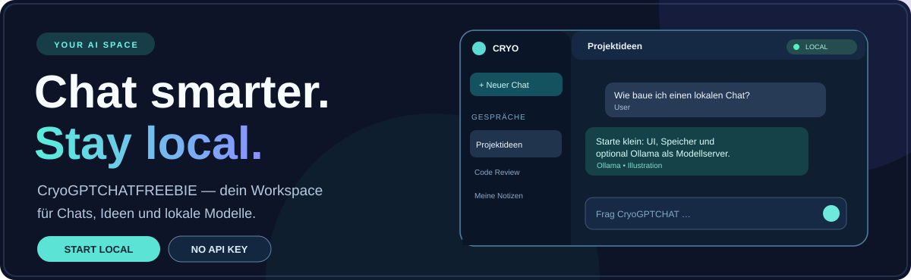
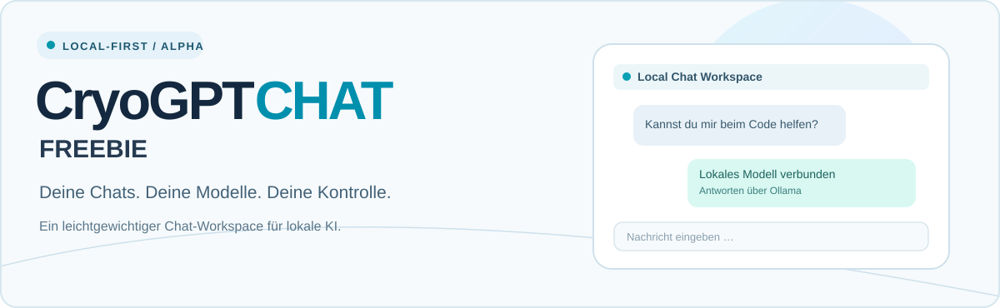
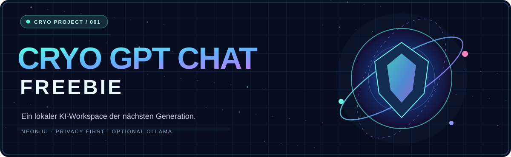
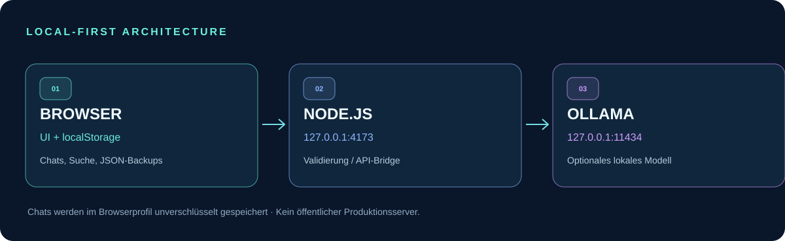

<div align="center">
  

  # ❄️ CryoGPTCHATFREEBIE

  **Deine Chats. Deine Modelle. Deine Kontrolle.**

  Ein responsiver Chat-Workspace mit **lokaler IndexedDB-Speicherung**, **JSON-Backups** und optionaler **Ollama-KI**.  
  Für Ideen, Code und Gespräche – ohne verpflichtenden Cloud-Dienst.

  <p>
    <code>ALPHA 0.3</code> ·
    <code>LOCAL-FIRST</code> ·
    <code>NODE.JS 20+</code> ·
    <code>OLLAMA OPTIONAL</code>
  </p>

  <p>
    <a href="#-in-60-sekunden-starten"><strong>▶ Jetzt starten</strong></a> ·
    <a href="#-was-dich-erwartet">Features</a> ·
    <a href="#-drei-designwelten">Designvarianten</a> ·
    <a href="#-roadmap">Roadmap</a>
  </p>
</div>

---

## ✨ Was dich erwartet

| 💬 **Gesprächszentrale** | 🧠 **Echte lokale KI** | 💾 **Deine Daten** |
| :--- | :--- | :--- |
| Chats anlegen, umbenennen, löschen und durchsuchen | Ollama-Modelle auf dem eigenen Rechner auswählen und ansprechen | IndexedDB im Browser, JSON-Export und validierter Import |

**Alpha 0.3 kann bereits:** responsive Neon-UI, Volltextsuche, lokale Chat-Verwaltung, Backups, Ollama-Erkennung, echte tokenweise Streaming-Antworten und eine Stopp-Schaltfläche bei angeschlossenem Modell. **Ohne Modell** wird die App zum lokalen Chat-Notizbuch; sie erfindet keine Antworten.

> 🎨 **Designhinweis:** Die Illustrationen dieser README zeigen die Gestaltungsidee – keine unbearbeiteten Screenshots der laufenden App.

## 🚀 In 60 Sekunden starten

**Voraussetzung:** [Node.js](https://nodejs.org/) 20 oder neuer. Keine externen npm-Abhängigkeiten.

```bash
git clone https://github.com/Pierreg99/CryoGPTCHATFREEBIE.git
cd CryoGPTCHATFREEBIE
npm start
```

Öffne danach **[http://127.0.0.1:4173](http://127.0.0.1:4173)** auf demselben Rechner.

### Optional: Ollama verbinden

1. [Ollama installieren](https://ollama.com/).
2. Ein kompaktes lokales Modell herunterladen: `ollama pull qwen2.5:3b`.
3. Ollama lokal unter `127.0.0.1:11434` betreiben.
4. In CryoGPTCHATFREEBIE die Modellliste aktualisieren und dein Modell auswählen.

Der Modellserver ist über `OLLAMA_URL` konfigurierbar. Eine Internetverbindung ist möglicherweise einmalig nötig, um das Modell herunterzuladen; **KI-Antworten benötigen danach keine obligatorische Cloud-API**.

## 🎨 Drei Designwelten

Hier stehen **drei vollständige, editierbare README-Alternativen** bereit. Jede hat ihren eigenen, lokal versionierten SVG-Header. Die Haupt-README kombiniert deren stärkste Elemente: Produktfokus, gute Lesbarkeit und Cryo-Neon-Identität.

<table>
<tr>
<td width="33%" align="center">
<a href="docs/readme-variants/01-clean.md"></a>
<br><strong>01 · Professional / Clean</strong>
<br>Minimalistisch, technisch, gut lesbar.
<br><a href="docs/readme-variants/01-clean.md">Variante öffnen →</a>
</td>
<td width="33%" align="center">
<a href="docs/readme-variants/02-neon.md"></a>
<br><strong>02 · Futuristic / Neon</strong>
<br>Holografisch, kontrastreich, cineastisch.
<br><a href="docs/readme-variants/02-neon.md">Variante öffnen →</a>
</td>
<td width="33%" align="center">
<a href="docs/readme-variants/03-product.md"></a>
<br><strong>03 · App / Landing Page</strong>
<br>Produktnutzen, Einstieg und FAQ.
<br><a href="docs/readme-variants/03-product.md">Variante öffnen →</a>
</td>
</tr>
</table>

**Alle Grafiken liegen im Repository:** [`assets/readme/`](assets/readme/). Keine externen Bild-CDNs notwendig.

## 🧩 So arbeitet CryoGPTCHAT



| Schicht | Dateien | Aufgabe |
| :--- | :--- | :--- |
| **Browser** | [`index.html`](index.html), [`src/app.js`](src/app.js), [`src/styles.css`](src/styles.css) | Chat-Oberfläche, Nachrichten, Sitzungen, Suche |
| **Chat-Core** | [`src/core.js`](src/core.js) | Datenlogik, Projektwissen und Backup-Validierung |
| **Speicherung** | [`src/storage.js`](src/storage.js) | IndexedDB-Snapshots, Migration und Fallback |
| **Local Server** | [`server.mjs`](server.mjs) | Localhost-Bridge und validierte Modell-Anfragen |
| **Tests & CI** | [`tests/core.test.js`](tests/core.test.js), [`.github/workflows/ci.yml`](.github/workflows/ci.yml) | Automatische Core-Tests |

### 🧪 Testen

```bash
npm test
```

Automatisierte Core-, Streaming- und IndexedDB-Migrationstests sowie Tests mit simuliertem Ollama-Server sind enthalten. **Nicht vollständig abgedeckt:** Browser-End-to-End-Flows und echte Ollama-Inferenz auf unterschiedlichen Endgeräten.

## 🔐 Datenschutz & Grenzen

- Chats und Projektwissen liegen **unverschlüsselt in IndexedDB** des jeweiligen Browserprofils. Falls IndexedDB nicht verfügbar ist, kommt \`localStorage\` als Fallback zum Einsatz. Auch JSON-Exporte sind unverschlüsselt.
- Beim Einsatz von Ollama wird Gesprächskontext an den konfigurierten Modellserver gesendet. Standardmäßig ist das der eigene Rechner.
- Der Node.js-Server bindet an `127.0.0.1`; es gibt **keine Authentifizierung und keinen Mehrbenutzerbetrieb**.
- **Nicht unverändert öffentlich ins Internet stellen.** Dies ist ein lokales Experiment, keine produktionsreife SaaS-Lösung.
- Vor einem JSON-Import ein Backup exportieren; bestätigter Import ersetzt den aktuellen Datenbestand.

## 🧠 Projektwissen je Chat

Über **„Projektwissen“** kannst du pro Unterhaltung wichtige Ziele, Architekturentscheidungen und Hintergrundinfos in einem eigenen Textfeld speichern (maximal **4.000 Zeichen**).

**Datenschutz und Kontrolle:** Standardmäßig werden diese Notizen **nicht** an das Modell gesendet. Erst wenn du **„Bei KI-Antworten berücksichtigen“** aktivierst und speicherst, werden sie bei der nächsten Anfrage als normaler, vom Nutzer bereitgestellter Kontext mitgegeben – **nicht** als privilegierte Systemanweisung. Bei einem extern konfigurierten Ollama-Endpunkt können diese Notizen folglich an diesen Server übertragen werden.

### Bessere Chat-Speicherung

- **IndexedDB:** gesamter Chat-Stand als atomarer Snapshot gespeichert; Schreibzugriffe erfolgen nacheinander.
- **Sichere Migration:** Beim ersten Start wird eine vorhandene Alpha-0.1/0.2-Speicherung aus `localStorage` gelesen, zu Backup-Version 2 migriert und erst **nach erfolgreichem IndexedDB-Commit** aus dem alten Speicher entfernt.
- **Alte Backups:** JSON-Backups mit Version 1 lassen sich weiterhin importieren. Neue Exporte enthalten auch das Projektwissen und die Freigabe-Einstellung.
- **Fallback:** Wenn IndexedDB nicht verfügbar ist, wird `localStorage` genutzt und eine Warnung angezeigt.
- **Kein Cloud-Sync und keine Verschlüsselung:** Browserdaten können beim Löschen des Profils verloren gehen; wichtige Chats regelmäßig als JSON exportieren.

**Noch nicht enthalten:** automatische Wissenssuche (RAG), Dateizugriff, GitHub-Sync, Skill-Ausführung oder browserübergreifende Synchronisierung.

## 🎮 Godot MCP – optionale lokale Projektprüfung

CryoGPTCHATFREEBIE kann über eine **manuell konfigurierte** Verbindung zu [Coding-Solo/godot-mcp](https://github.com/Coding-Solo/godot-mcp) zwei Godot-Abfragen ausführen:

- **Installierte Godot-Version** anzeigen (`get_godot_version`)
- **Projektmetadaten** für einen fest konfigurierten lokalen Godot-Projektordner auslesen (`get_project_info`)

Über den Button **🎮 Godot MCP** öffnet sich ein eigenes Panel. Jede Abfrage erfordert einen weiteren Bestätigungsdialog. Ohne lokale Installation bleibt das Panel deaktiviert; KI-Modelle können nicht automatisch auf Godot-Werkzeuge zugreifen.

**Keine Szene bearbeiten, kein Spiel starten, keine automatische Skriptausführung durch den Chat.** Der externe Godot-MCP-Prozess selbst ist ausführbarer Fremdcode und muss vor der Verwendung geprüft werden. Die Integration ersetzt weder eine Sicherheitsprüfung noch eine echte Godot-End-to-End-Testumgebung.

**[Godot MCP installieren und sicher konfigurieren →](docs/integrations/godot-mcp.md)**

## 🛣️ Roadmap

- [x] **Alpha 0.1:** Chat-UI, Gesprächsverwaltung, Suche, JSON-Backups und optionale Ollama-Integration.
- [x] **Alpha 0.2:** Streaming-Ausgabe, Stopp-Schaltfläche, gekennzeichnete Teilantworten, manuelle Modellauswahl und neue Stream-Tests.
- [x] **Alpha 0.3 (erster Schritt):** IndexedDB-Migration, versionierte Backups und manuell freigegebenes Projektwissen pro Chat.
- [ ] **Alpha 0.3 (weitere Schritte):** Browser-E2E, Accessibility und robuste größere Chatverläufe.
- [ ] **Zukunft:** Kontrollierte Cryo-Omega-Skill-Registry, Projektwissen und Agenten-Workflows.

## 🤝 Mitmachen

Für Bugs, Ideen und Verbesserungsvorschläge: [Issues öffnen](https://github.com/Pierreg99/CryoGPTCHATFREEBIE/issues). Bitte keine API-Schlüssel oder Chat-Backups in öffentlichen Issues teilen. Pull Requests sollten `npm test` bestehen.

---

<div align="center">
  
  <p><sub>CRYO GPT CHAT FREEBIE · BUILD LOCAL · THINK BIG</sub></p>
</div>
